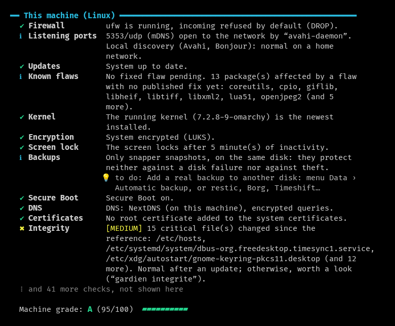
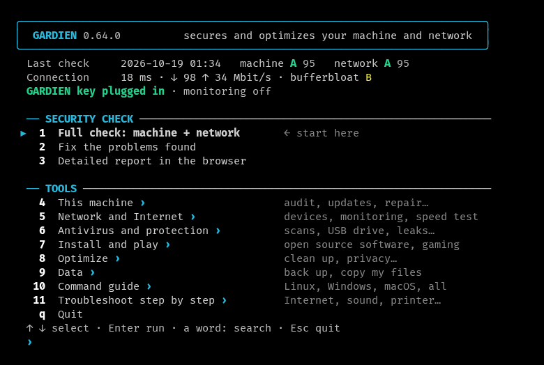
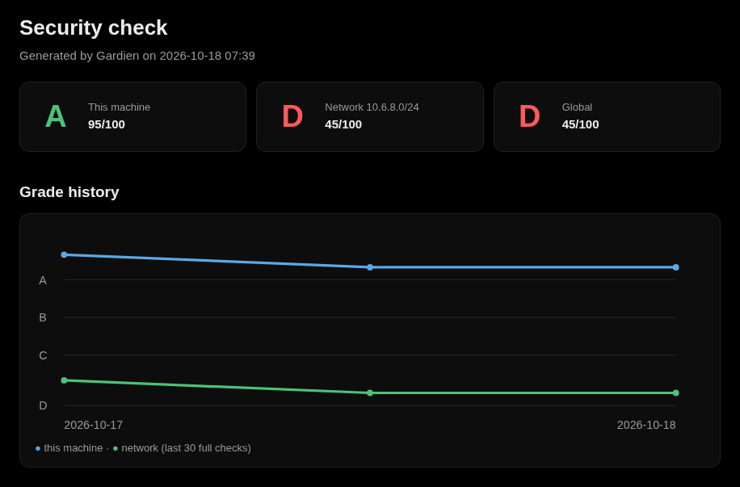
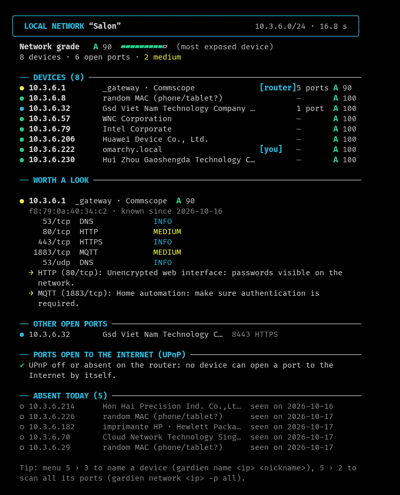
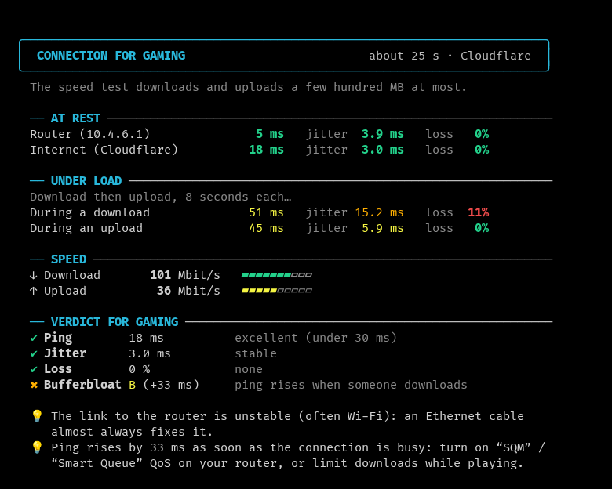

  

<h1 align="center">Gardien</h1>

<a href="README.md">Français</a> · <b>English</b>

  <b>Secures and optimizes your computer and your network, from a USB key.</b> 
  Gardien (French for “guardian”) checks your machine and every device on your network, explains each problem in
  plain language, and fixes it once you agree. Linux, Windows and macOS, nothing to install, in English or French.

## At a glance

- **A security check graded from A to F**: firewall, updates, encryption, open ports, backups… Each problem is
  explained simply, with its fix.
- **Your whole network**: every device, its manufacturer, its open ports and its risks; newcomers are flagged.
- **Nothing changes without your consent**: a restore point first, and every setting is undone exactly.
- **One USB key for all your computers**, and your friends': it write-protects itself anywhere but at home.

## Getting started

**Download** (latest version): [Windows](../../releases/latest/download/gardien-windows-x86_64.exe) ·
[Linux](../../releases/latest/download/gardien-linux-x86_64) · [macOS](../../releases/latest/download/gardien-macos)
— or the whole [releases page](../../releases/latest), with the SHA-256 checksums. What each version brought:
[history](CHANGELOG.en.md).

- **Windows**: double-click the program. It is not signed: SmartScreen may warn (“More info”, then “Run anyway”).
  Microsoft Defender sometimes mistakes it for a virus (“Trojan:Win32/Bearfoos.A!ml”, an automatic detection of
  a new program): it is a false positive; check the SHA-256 checksum on the release page.
- **Linux**: `chmod +x gardien-linux-x86_64`, then `./gardien-linux-x86_64` in a terminal (any distribution, nothing
  to install).
- **macOS**: copied from the Internet, the program is blocked the first time: `xattr -d com.apple.quarantine
  gardien-macos`, then `./gardien-macos` in Terminal.
- **From the USB key**: `Windows/gardien.exe`, `Linux/gardien`, or `Lancer Gardien.command` on macOS; the key's guide
  is in `README.txt`.

In the menu, choose **1** (full check), then **2** (fix). Arrows, Enter, and Esc or Backspace to go back.

## What Gardien does

| Area | What Gardien does |
|---|---|
| **Security check** | A grade from A to F: firewall, updates and vulnerabilities, encryption, open ports, accounts, SSH, what starts in secret, shares open to everyone, Wi-Fi, Bluetooth, clock, end of support, forgotten accounts, browser passwords, sensitive files lying around, disk health… Each problem is explained, with its fix. |
| **Local network** | Every device, its manufacturer, its open ports and its risks; newcomers flagged, ports opened on the router, the home's address on a blocklist. |
| **Wi-Fi, NAT, DNS, cameras** | The freest Wi-Fi channel, the NAT type for gaming, the fastest DNS (without removing a DNS that protects you), hidden cameras. |
| **Connection for gaming** | Ping, jitter, loss, speed and bufferbloat, compared with your habits. |
| **Troubleshoot** | Computer diagnostic, everyday problems step by step (Internet, Wi-Fi, slowness, sound, printer, full disk), after an infection, new computer, computer leaving, hacked account, “Why is it slow?”, computer specs, report to leave, repairs. |
| **Optimize and clean up** | Privacy and performance settings undone exactly, a cleanup checklist with the space gained measured, startup programs. |
| **Protection** | Decoy files against ransomware, Windows Defender blocking, 308 YARA rules, antivirus, sandbox, integrity of critical files, leaked passwords, outbound connections, tech-support scam (remote control tools), camera and microphone, dangerous links, downloaded files, reversible quarantine. |
| **Follow-up** | Hourly monitoring, monthly check-up, HTML report with the grade curve, learning on your computer, what Gardien changed (each fix, dated). |
| **Software and games** | The best software in 8 categories, from its official source; update everything at once; settings for gaming. |
| **Tools** | Automatic backup, copy my files (checked copy) and check a copy, check my drive (fake drives, speed), my computers (tracked by the key), key data protected by a passphrase, shortcut on this computer, command guide, search in every menu. |

<b>The details, feature by feature</b>

**Security check** — a grade from A to F, then each problem with its fix.
- Firewall, open ports (TCP and UDP), updates and known vulnerabilities, disk encryption, Secure Boot, screen lock,
  accounts, SSH (and its failed login attempts, from the Internet or from home, and a client that does not check servers), sudo, groups worth root (docker,
  lxd, libvirt, disk), kernel hardening (on macOS: sealed system volume, enforced code signing, library
  validation, added extensions), badly protected secret files, backups, file shares open to everyone (Samba, NFS,
  Windows shares, macOS File Sharing: the password-less access is closed after your consent, named accounts keep
  theirs).
- What hides: programs started at boot, scheduled tasks, library preloading, modified privileged programs.
- The DNS actually used (and forged answers), added root certificates (HTTPS interception), browser extensions that
  read every site.
- Wi-Fi: the network's protection (WEP, WPA2, WPA3), and fake access points ("evil twin") that copy its name without
  a password to lure devices; on Linux, saved open networks that reconnect by themselves.
- Bluetooth: computer visible all the time, and devices paired less than a week ago (a keyboard paired by someone
  else types whatever it wants).
- Clock set automatically; end of support: Windows 10 and the Windows 11 or macOS versions that no longer get fixes,
  programs abandoned by their publisher (Flash, Java 7, Office 2016…), browsers that no longer update; forgotten
  accounts (active but unused for six months); new administrators.
- Windows: WDigest (passwords in clear text in memory), Local Security Authority protection, PowerShell 2.0, Remote
  Assistance, automatic sign-in (and password in clear text in the registry), SmartScreen off, account control off
  for remote connections, memory integrity, paused updates, LM or NTLMv1 network authentication, share signing,
  PowerShell running any script, UAC that asks nothing, guest access to shares, accounts listed without a password,
  Secure Boot, suspended BitLocker, Defender cloud protection off, overly broad Defender exclusions, Office macros
  all allowed, passwords kept as LM hashes, Remote Registry, SMBv1 client, MSI installs with system rights, services
  with unquoted paths, exploit protection off, Windows Update turned off; Linux: automatic security updates, session
  that opens by itself without an encrypted disk; macOS: unencrypted Time Machine backup.
- Hijacked browsing (forced proxy, sites redirected by the hosts file).
- Passwords saved in the browser without protection, sensitive files lying around (passwords or keys in clear text),
  missing backup with its set-up offered.
- Health: disk space, SMART status of the disks (without root), battery, temperatures.
- What could not be checked is said so, never counted as healthy.

**Local network** — every device, its manufacturer, its open ports (TCP, and UDP: SNMP, NetBIOS, UPnP, DNS, mDNS)
and its risks; newcomers flagged, one notebook per network (at home, at each friend's), nicknames ("HP printer");
the ports that devices opened to the Internet on the router through UPnP (read-only, with miniupnpc on Linux).
After your consent, the home's Internet address is looked up in four blocklists (Spamhaus, SpamCop, DroneBL, PSBL):
listed for spam or attacks, a device is probably infected.

**Connection for gaming** — ping, jitter, loss, speed and bufferbloat (the lag when someone downloads), with a
verdict criterion by criterion and advice.

**Wi-Fi, NAT, DNS and cameras** — crowded Wi-Fi: nearby networks by channel, and the freest channel to set on the
router; the NAT type for gaming (open, moderate or strict, as consoles show it), double NAT and provider-shared
address included; the fastest DNS, measured here, offered only if it does not replace a DNS that protects you
(NextDNS, encrypted, filtering), and undoable; and, in a rental or at someone's place, the devices on the network
that look like cameras (maker, video stream, ONVIF), without turning anything off or watching anything.

**Computer diagnostic** — the first step of any troubleshooting: hardware, system, and recent problems (journal
errors and crashed programs on Linux; blue screens, sudden shutdowns and crashes on Windows; kernel panics and crash
reports on macOS), with a text copy saved on the key.

**Troubleshoot step by step** — everyday problems, handled the way someone who knows would: no Internet, Wi-Fi
dropping, slow computer, no sound, printer not working, disk full. Two or three questions, then Gardien checks by
itself (address, router, Internet, DNS; Wi-Fi signal; sound service and selected output; print queue and printer on
the network; disk space) and suggests the right repair or the right tool, always with your consent. And three
journeys for the big moments: **after an infection** (what is urgent depending on the sign, the check of what may
have been installed, the scans in order, then the passwords to change, email first); **new computer** (updates,
encryption, backups, starter pack, privacy, in order); **computer leaving**, sold or given (verified copy first,
accounts signed out, BitLocker or FileVault key set aside, secure wipe by the system's tool, TPM chip cleared).
Gardien never wipes anything itself. And **my account was hacked**: take back control through the
official page, then password, two-step verification, sessions signed out, and a check that this computer did not
give the password away. Slow **since an update**: the latest updates, dated, and how to go back.

**Report to leave** — a simple page for the person you just helped: their grade, what is left to do from the most
to the least serious, what is fine and three habits; put on their Desktop, to read or print.

**Automatic backup** — set up with the system's tool (Déjà Dup or a daily rsync copy on Linux, Time Machine, File
History on Windows), to an external disk, after your consent and undoable. **Shortcut on this computer**: Gardien
copied here and started with one click.

**Why is it slow?** — a two-second snapshot: what keeps the processor, memory and disk busy, program by program;
how long startup takes and what delays it; the programs started at login and their weight. Those that work for a
while then calm down (antivirus scanning, indexing, updates) are named as such. Startup programs are removed from
there, after your consent: they stay installed, and each removal is undone exactly (`gardien startup`).

**Computer specs** — model, motherboard, BIOS, processor, memory (modules, type, speed), graphics card and driver,
disks: what you are asked on the phone or to buy a part. Serial numbers are shown on screen only, never written.

**Copy my files** — Documents, Pictures, Desktop, Videos and Music to an external disk, before a risky repair or a
reinstall: space is checked first, each file is read back and compared with the original (BLAKE3 fingerprint),
nothing is deleted or overwritten, and an interrupted copy resumes where it stopped. **Check a copy**, later, is the
restore test: files spread over the whole copy are read back from the disk and compared with their original; a disk
that loses data shows up before the day you need it.

**Check my drive** — does a USB stick or an external disk hold what it claims? Fake drives (a 16 GB chip sold as
“1 TB”) accept everything and return garbage beyond their real size. After your consent, Gardien writes recognizable
content into the free space, reads it all back bypassing the computer's memory, measures the write and read speeds,
then erases everything; the files already on the drive are not touched. Quick (a quarter of the free space) or full
(all of it, the only proof); never on the GARDIEN key or the system disk.

**My computers** — each full check run with the GARDIEN key notes the computer there: nickname (“system · model”,
renamable), grade, remaining problems (their category and level only, the five worst), date of the last check. The
table travels on the key's GARDIENLOG partition, without computer name, account, address or Wi-Fi name; it never
goes to GitHub.

**Protect the key's data** — the key's device record (names, MAC addresses, nicknames) encrypted by a passphrase
(XChaCha20-Poly1305, passphrase derived by Argon2id), against a lost or lent key. At home, nothing changes: the data
key is kept on the owner's computer. Elsewhere, Gardien asks for the passphrase, or goes on without the record. The
report and the diagnostic are no longer written to the key. On request, reversible, with a backup offered first; the
check reports a record left in clear.

**Optimize** — privacy, performance and comfort settings written for Gardien. On Windows: telemetry kept to a
minimum, ads and tracking off, Recall without screen snapshots, file extensions shown, no autorun from USB drives,
fast startup, full right-click menu. On Linux: SSD maintenance, journal size, reports sent by GNOME or Ubuntu. On
macOS: ads, analytics, no .DS_Store on drives. Each setting shows its state and is undone exactly: the previous value
is recorded, then put back. None of them weakens security.

**Clean up the system** — a checklist of what takes space for nothing: downloaded and unneeded packages, old Snap
versions, unused Flatpak runtimes, AUR builds, old caches, thumbnails, old logs, crash reports (Linux); temporary
files, Windows Update and Delivery Optimization caches, old components (Windows); old caches, Homebrew, Xcode, local
snapshots (macOS). The space each item frees is measured first, what rebuilds itself is checked by default, the trash
never; the free space read again afterwards tells what was really gained.

**Against ransomware and malware** — decoy files: a decoy text file and PDF in Documents, Pictures and Desktop,
which nobody has a reason to touch. Ransomware that encrypts or renames them triggers a critical alert, at each
check and hourly through monitoring, with what to do; placed and removed after your consent. And a YARA scan: 308
ReversingLabs rules that recognize whole families (ransomware, password stealers, trojans, backdoors…), alongside
the antivirus. What the antivirus or YARA finds can go into a
reversible quarantine: the file is made unusable and noted, then put back exactly in its place if it was a false
positive.

**Camera and microphone: who uses them?** — on Windows, each program that used the camera or the microphone, and the
last time (a program started from a temporary folder or Downloads is flagged); on Linux, what holds them right now.
Read-only.

**Windows Defender blocking** — Gardien blocks nothing itself: after your consent, it turns on what Windows blocks
from its kernel and protects against being turned off. Attack surface reduction rules (password theft from memory,
vulnerable drivers, booby-trapped Office documents and attachments), network protection against dangerous sites,
unwanted software, controlled folder access against ransomware. Each rule is named before you agree and undoes
exactly; those that would block Gardien on its USB drive or troubleshooting are never turned on, and nothing is
offered when another antivirus replaces Defender.

**Learning** — Gardien learns on your computer, sending nothing. An alert you declare normal for you ("i" when it is
offered as a fix) drops to information for 90 days, or until it gets worse; each connection test is compared with
your habits on the same network; a known device that suddenly seems all closed (asleep) is checked again more
patiently. "What Gardien has learned" shows everything and lets you forget.

**Command guide** — the useful commands of Linux, Windows, macOS and the ones typed the same way everywhere
(Gardien, ping, nslookup, ssh, curl, git…), sorted by system, then by program, each one explained; ⚠ marks the
ones that change something. Nothing runs from there: you read, then type the command, or copy it by its number,
here or on the computer of the person you help. Every system can be read everywhere (Windows commands from Linux, for
example), and the guide tells when a program is missing on this computer.

**And also**
- Search in every menu and checklist: type a word (wifi, disk, dns, update…), only the lines containing it stay,
  whatever the accents or capitals; in the main menu, it also finds each tool of the submenus and each page of the
  guide.
- Fixes applied only after confirmation, with a restore point created automatically beforehand (snapper or
  timeshift on Linux, Windows restore point, Time Machine snapshot on macOS); on Windows, each one is a readable
  script.
- Update everything at once: system, programs, drivers, firmware.
- Software: the best program for each use, mostly open source, in 8 categories (browsers and email, messaging and
  sharing, security and privacy, office, video and music, images and design, system tools, programming) plus a
  starter pack (Firefox, Bitwarden, VLC, LibreOffice, 7-Zip): checklist, installed ones recognized, installation from
  the official source that checks each download (winget, distribution packages or Flathub, Homebrew).
- Repairs: Internet, hijacked browsing, firewall, disk, full disk, deep cleaning, stuck Windows Update, system files,
  clock.
- Antivirus: ClamAV (Linux, macOS) or Microsoft Defender (Windows), on the computer or on a chosen USB key / folder,
  with the tricks of USB worms (shortcut posing as a folder, autorun.inf, scripts).
- Sandbox: run an unknown program without network, with a read-only system and an invisible home folder (bubblewrap
  or firejail on Linux, Windows Sandbox on Windows, sandbox-exec on macOS).
- Integrity of critical files (accounts, sudo, SSH, PAM, cron, services, autostart): BLAKE3 fingerprints, what changed
  since the reference, and live monitoring.
- Leaked passwords: checked with Have I Been Pwned without ever sending the password (only 5 characters of its hash);
  email address leaks, after your consent (the address is sent to the service).
- Who talks to the Internet?: each program's current connections, with the server's name; a program started from a
  temporary folder or Downloads, a remote access tool's port or a server without a name are flagged. Read-only:
  nothing is cut.
- Is someone controlling my PC?: the tech-support scam (“your computer is infected”) gets a remote control tool
  installed. Gardien looks for AnyDesk, TeamViewer, RustDesk, Quick Assist, Splashtop, UltraViewer… installed (and
  since when), started at boot, running or simply sitting in Downloads; it explains what to do (cut the Internet, tell
  the bank, change passwords) and removes them after your consent. A running program is never cut without a second,
  explicit consent: the person helping may be connected through it. In the check too (“Remote access”).
- Is this link dangerous?: a link you received, checked without ever opening it (disguised letters, misleading
  subdomain, imitated brand, link shortener, raw IP address); after your consent, the domain's age and three public
  lists of dangerous sites (URLhaus, Spamhaus, SURBL). Only the domain name leaves the computer.
- Check Gardien itself: its version, the date of its last commit and its SHA-256 checksum, to compare with the
  release page (Gardien is not signed: this comparison is what proves it is genuine). A copy older than six months
  says so in the menu. And the key manifest: at deployment, the checksum of every file on the key is kept on your
  computer; back from someone's place, the check names what was added, replaced or removed (a planted autorun, a
  replaced program). Data, ISO images and the Ventoy menu, which change normally, are not compared. Each key has
  its own reference (recognized by its volume identifier): a second GARDIEN key does not pass for a modified one.
- Gardien also distrusts itself: at startup, it says whether a library is injected into every program of the
  session (LD_PRELOAD, DYLD_INSERT_LIBRARIES, AppInit_DLLs: one from a system package, like GameMode, is a mere
  information) and whether it runs as root for no reason, since its results go through there. In the check: the
  hourly monitoring you had turned on and that disappeared (malware first cuts what watches it), and the check
  history rewritten afterwards (each check carries the previous one's checksum). Every night, CI builds Gardien
  twice and checks that the program is identical to the byte.
- Check a downloaded file: its checksum compared with the one the site publishes (pasted, or a SHA256SUMS next to
  it), its name and content (double extension, program disguised as a document), then YARA and the antivirus.
- Hourly monitoring: a notification if an unknown device shows up, if a port opens, if the machine's grade drops, if
  the router seems spoofed (shared or changed MAC address: ARP spoofing), or if a program or a disguised file lands
  in Downloads (to check before opening it; nothing is blocked).
- Monthly check-up: one notification a month with the machine's grade, waiting updates, the space a cleanup would
  free and new problems; nothing is changed.
- HTML report with the grade history curve, and what changed since the previous check.
- Gaming: on Windows, game components and Windows settings; on Linux, Steam, 32- and 64-bit Vulkan drivers for your
  graphics card, GameMode, MangoHud, Gamescope, Wine, Lutris, Heroic, ProtonUp-Qt, vm.max_map_count, ntsync; on
  macOS, Rosetta 2, Steam, Heroic, Epic Games, GOG Galaxy, Prism Launcher and the Metal frame counter.

Gardien never cuts a remote connection in use (Remote Desktop, SSH). Only use it on your own network, or a network
you are allowed to audit.

## In pictures

<table>
  <tr>
    <td width="50%"> The menu: last check,
    connection, key plugged in.</td>
    <td width="50%"> The HTML report and
    the grade history.</td>
  </tr>
  <tr>
    <td width="50%"> The network: every
    device, its ports and what deserves a look.</td>
    <td width="50%"> The
    connection for gaming: ping, jitter, speed, bufferbloat.</td>
  </tr>
</table>

Screenshots retaken at each version, on a copy of the data; the home's addresses and names are masked.

## Supported systems

| System | Versions |
|---|---|
| Windows | 10 and 11 |
| macOS | 12 and later, Apple Silicon and Intel (tested on GitHub's Macs, not yet on a real Mac) |
| Linux | Arch and derivatives (Omarchy, Manjaro, EndeavourOS, CachyOS), Debian, Ubuntu, Mint, Pop!_OS, Fedora (and RHEL, Rocky, Nobara), openSUSE |
| Atomic Linux | Bazzite, Silverblue, Kinoite, Bluefin, Aeon |

Gardien recognizes the distribution and offers its own commands: `omarchy update` / `omarchy pkg add` on Omarchy,
`ujust update` on Bazzite, `rpm-ostree` or `transactional-update` on an atomic system, otherwise pacman, apt, dnf or
zypper.

## Commands

Each menu entry is also a command.

<b>All the commands</b>

| Command | Purpose |
|---|---|
| `gardien full [--html] [--text]` | full check: machine + network; `--text` shows it as plain text (emergency mode) |
| `gardien fix` | fix the problems found |
| `gardien audit [--json]` | audit of this machine |
| `gardien network [target] [-p common\|all\|22,80,8000-8100] [--json]` | scan the network or one device |
| `gardien connection` | connection test for gaming |
| `gardien clean [--list]` | clean up the system; `--list`: the space to gain, deleting nothing |
| `gardien apps [--list] [--recommended]` | software to install by category; `--list`: their state, installing nothing |
| `gardien diag` | computer diagnostic: hardware, system, recent crashes and errors |
| `gardien troubleshoot [subject]` | troubleshoot step by step: `internet`, `wifi`, `slow`, `sound`, `printer`, `disk`, `infection`, `new`, `leaving`, `account` |
| `gardien slow` | why it is slow: processor, memory, disk, startup, programs at login |
| `gardien startup` | startup programs: remove or put them back, after your consent; each removal is undone exactly |
| `gardien changes` | what Gardien changed: each fix run here, its date and its result |
| `gardien handout` | report to leave: a simple page for the person you helped |
| `gardien auto-backup [--annuler]` | automatic backup to an external disk, with the system's tool |
| `gardien shortcut [on\|off]` | shortcut on this computer |
| `gardien specs [--json]` | computer specs; `--json` without the serial numbers |
| `gardien copy-files [destination]` | copy my files to an external disk, checked copy |
| `gardien check-drive [folder]` | check my drive: real capacity, speeds, bad blocks (writes into the free space after your consent, then erases) |
| `gardien check-copy [folder]` | check a copy: read back from the disk and compared with the originals (restore test) |
| `gardien antivirus [--complet] [folder]` | antivirus scan (computer, or a key / a folder) |
| `gardien yara [--complet] [folder]` | YARA scan: 308 rules for malware families |
| `gardien decoys [--retirer]` | decoy files against ransomware: place them, check them, remove them |
| `gardien harden` | Windows Defender blocking: ASR rules, network protection, unwanted software, controlled folder access; each after your consent, undoable (Windows) |
| `gardien blocklists` | the home's Internet address on a blocklist? (after your consent) |
| `gardien channels` | crowded Wi-Fi: nearby networks by channel, and the freest channel |
| `gardien nat` | NAT type for gaming: open, moderate or strict |
| `gardien cameras` | hidden cameras on the network (rental, someone else's place) |
| `gardien fast-dns` | fastest DNS, measured here and undoable; a DNS that protects you is kept |
| `gardien learned` | what Gardien has learned: your habits, your choices, and forgetting them |
| `gardien password` | leaked passwords |
| `gardien sandbox <file>` | run an unknown program in a sandbox (bubblewrap or firejail, Windows Sandbox) |
| `gardien email` | email address leaks (XposedOrNot, or Have I Been Pwned with `GARDIEN_HIBP_CLE`) |
| `gardien outbound` | who talks to the Internet: each program's connections (read-only) |
| `gardien self-check` | check Gardien itself: version, build date, SHA-256 checksum to compare with the release page; on the owner's key, the key manifest |
| `gardien camera-mic` | camera and microphone: who uses them? (read-only) |
| `gardien quarantine` | the isolated files, to put back in their place or to delete |
| `gardien remote-access` | is someone controlling my PC? remote control tools (tech-support scam), removed after consent |
| `gardien link <address>` | is this link dangerous? (checked without opening it; online after your consent) |
| `gardien check-file <file> [checksum]` | check a downloaded file: checksum, name and content, YARA, antivirus |
| `gardien integrity [--accept] [--live]` | integrity of critical files (BLAKE3 fingerprints), live if wanted |
| `gardien update` | updates |
| `gardien repair` | repairs and cleaning |
| `gardien monitor on\|off` | hourly monitoring |
| `gardien maintenance [on\|off]` | monthly check-up; without argument: what it would say now |
| `gardien name <ip\|mac> <nickname>` | name a device |
| `gardien backup [file]`, `gardien restore <file>` | data backup |
| `gardien gaming` | packages and settings for gaming (Windows and Linux) |
| `gardien guide [system\|program\|words]` | command guide: a system (`linux`, `windows`, `macos`, `all`), a program (`winget`, `systemctl`…) or words to look for (`dns cache`) |

**Language**: the system's (English or French). To force it: `GARDIEN_LANG=en` or `GARDIEN_LANG=fr`. The commands
also keep their French names (`complet`, `machine`, `corriger`, `reseau`, `connexion`, `logiciels`, `diagnostic`,
`motdepasse`, `isoler`, `courriel`, `integrite`, `maj`, `reparer`, `surveillance`, `nommer`, `sauvegarder`,
`restaurer`, `nettoyer`, `pieges`, `durcir`, `listes-noires`, `appris`, `entretien`, `sortantes`, `lien`,
`verifier-fichier`, `canaux`, `dns-rapide`).

**Emojis**: in the old Windows console (command prompt or PowerShell outside Windows Terminal, common on Windows 10),
which draws them badly and shifts the menus, 💡 and 🔧 become → and +. `GARDIEN_EMOJI=0` removes them everywhere,
`GARDIEN_EMOJI=1` keeps them everywhere.

## Development

Building, testing, deploying, the USB key, the error journal: see [CONTRIBUTING.en.md](CONTRIBUTING.en.md).
A security flaw in Gardien? Report it privately: see [SECURITY.md](SECURITY.md#security).

## License

© 2026 d9v3. Gardien is free software: you can redistribute it and modify it under the terms of the
[GNU General Public License](LICENSE) (GPL), version 3 or any later version. It comes with no warranty. A modified
version you distribute must stay under this license, with its source code.

The included libraries keep their own licenses (MIT, Apache-2.0, BSD, ISC…): see `LICENCES-TIERCES.txt`.
