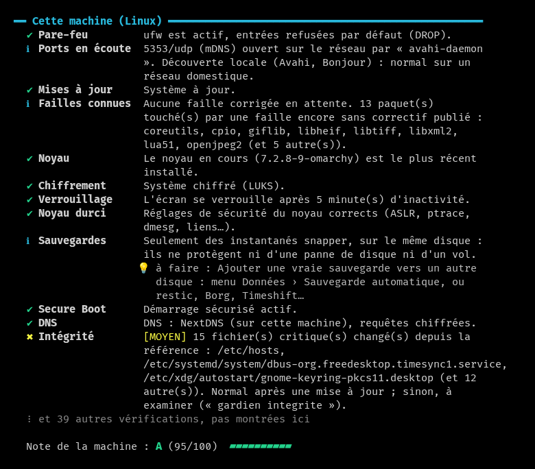
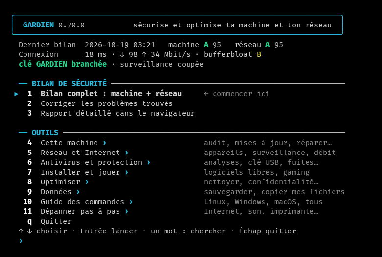
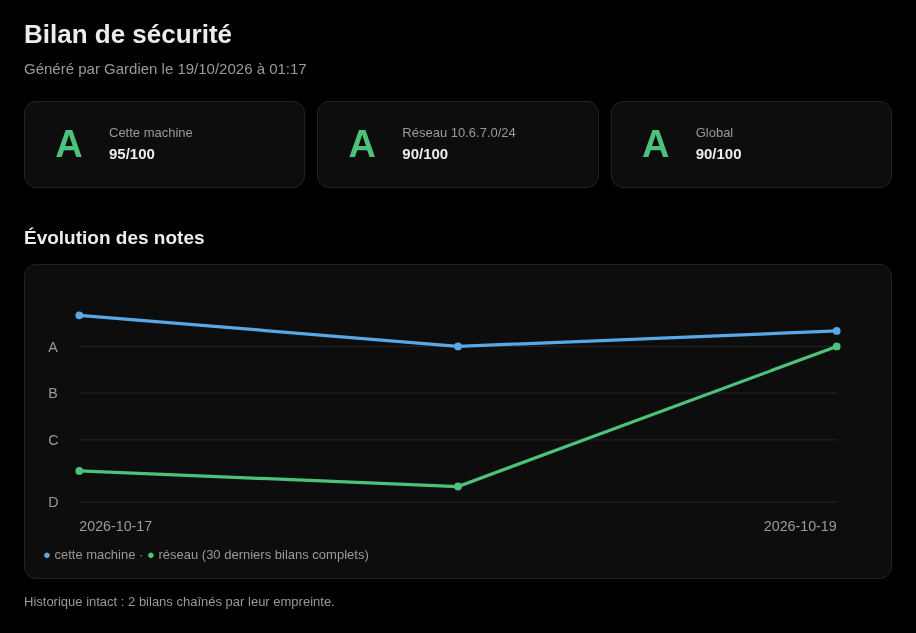
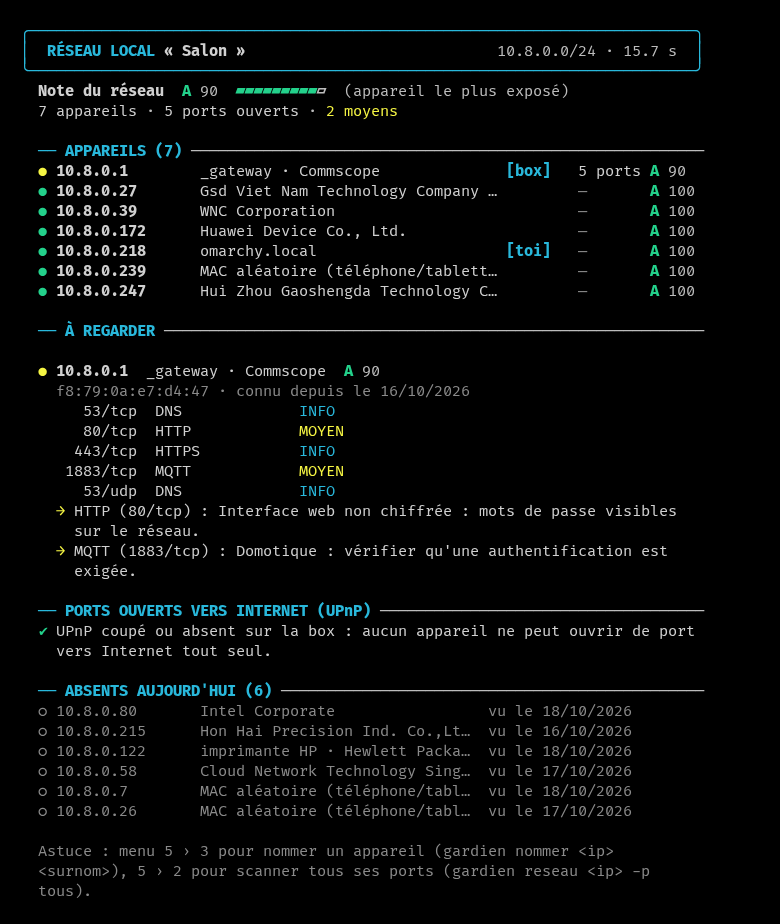
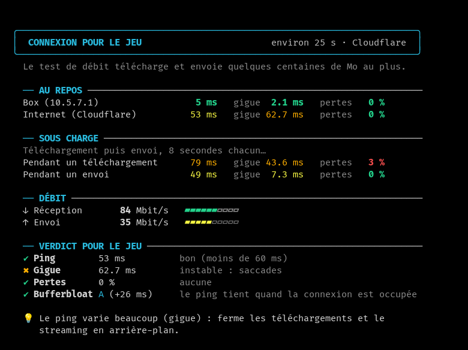

<h1 align="center"><picture><source media="(prefers-color-scheme: dark)" srcset="assets/banniere-blanche.png"></picture></h1>

<b>Français</b> · <a href="README.en.md">English</a>

  <b>La cyberdéfense de ton foyer, depuis une clé USB.</b> 
  Vanguard vérifie ta machine et tous les appareils de ton réseau, explique chaque menace en français clair, 
  et la corrige après ton accord ; quand quelque chose ne marche plus, il aide aussi à dépanner. 
  Linux, Windows et macOS, sans installation, en français ou en anglais.

## En bref

- **Les menaces d'un foyer, une par une** : ce que la box expose à Internet, un intrus sur le Wi-Fi, un objet
  connecté vulnérable, un ordinateur infecté, un DNS ou un certificat détourné, les arnaques. Chaque problème est
  expliqué simplement, avec sa correction.
- **Un bilan noté de A à F** : pare-feu, mises à jour, chiffrement, ports ouverts, sauvegardes…
- **Tout ton réseau** : chaque appareil, son fabricant, ses ports ouverts et ses risques ; les nouveaux venus sont
  signalés.
- **Rien n'est changé sans ton accord** : un point de restauration d'abord, et chaque réglage s'annule exactement.
- **Et le dépannage** : diagnostic, pannes de tous les jours pas à pas, lenteur, l'ordinateur d'un proche,
  réparations.
- **Une clé USB pour tous tes ordinateurs**, et ceux de tes amis : elle se protège elle-même en écriture ailleurs que
  chez toi.

## Démarrer

**Télécharger** (dernière version) : [Windows](../../releases/latest/download/vanguard-windows-x86_64.exe) ·
[Linux](../../releases/latest/download/vanguard-linux-x86_64) · [macOS](../../releases/latest/download/vanguard-macos)
— ou toute la [page des versions](../../releases/latest), avec les empreintes SHA-256. Ce qu'a apporté chaque
version : [historique](CHANGELOG.md).

- **Windows** : double-clic sur le programme. Il n'est pas signé : SmartScreen peut avertir (« Informations
  complémentaires » puis « Exécuter quand même »). Microsoft Defender le prend parfois à tort pour un virus
  (« Trojan:Win32/Bearfoos.A!ml », une détection automatique sur un programme neuf) : c'est un faux positif ;
  vérifie l'empreinte SHA-256 sur la page de la version.
- **Linux** : `chmod +x vanguard-linux-x86_64`, puis `./vanguard-linux-x86_64` dans un terminal (toutes les
  distributions, rien à installer).
- **macOS** : copié depuis Internet, le programme est bloqué la première fois : `xattr -d com.apple.quarantine
  vanguard-macos`, puis `./vanguard-macos` dans le Terminal.
- **Depuis la clé USB** : `Windows/vanguard.exe`, `Linux/vanguard`, ou `Lancer Vanguard.command` sous macOS ; le guide
  de la clé est dans `LISEZMOI.txt`.

Dans le menu, choisis **1** (bilan complet), puis **2** (corriger). Les flèches, Entrée, et Échap ou Retour arrière
pour revenir.

## Ce que fait Vanguard

| Menace ou domaine | Ce que fait Vanguard |
|---|---|
| **Le bilan** | Une note de A à F sur tout ce qui suit, et aussi : pare-feu, mises à jour et failles connues, chiffrement, comptes, SSH, partages ouverts à tous, heure, fin de support, comptes oubliés, santé des disques… Chaque problème est expliqué, avec sa correction, appliquée après ton accord. |
| **Exposition vers Internet** | L'audit du réseau en six notes (exposition, Wi-Fi, séparation des appareils, DNS et certificats, objets connectés, ordinateurs) ; les ports que la box ouvre vers Internet (UPnP), les ports ouverts et le pare-feu de cet ordinateur, l'adresse de la maison sur liste noire, la page d'administration de la box en HTTP seul. |
| **Intrus sur le Wi-Fi** | Chaque appareil du réseau, son fabricant, ses ports ouverts et ses risques ; les nouveaux venus signalés toutes les heures, avec un tableau de bord dans le navigateur ; la protection du Wi-Fi (WEP, WPA2, WPA3), le faux point d'accès qui copie son nom, les appareils Bluetooth appairés depuis peu. |
| **Objets connectés** | La box et les objets du réseau (caméras, imprimantes, NAS, télés, domotique…) reconnus, avec leur mot de passe d'origine à changer ; les caméras cachées, dans une location ou chez quelqu'un. |
| **Poste infecté** | Antivirus, 308 règles YARA et plus d'un million d'empreintes de logiciels malveillants connus (MalwareBazaar), la mémoire des programmes qui tournent (à la demande), la chasse aux menaces en direct (mot de passe deviné, programmes en marche suspects), fichiers-pièges contre les rançongiciels, blocages de Windows Defender, ce qui se lance en cachette, portes dérobées, portes cachées de Windows et pilotes vulnérables, signes de rootkit, journaux d'événements suspects, connexions vers des serveurs de botnets connus, un voleur de mots de passe comme Responder démasqué, agents d'IA trop permissifs, intégrité des fichiers critiques, failles des images Docker (trivy, s'il est installé), quarantaine réversible, et les traces collectées avant de nettoyer, avec la chronologie de l'incident. |
| **DNS et certificats détournés** | Le DNS réellement utilisé (et les réponses inventées), les certificats racine ajoutés (interception du HTTPS), le proxy imposé et les sites redirigés par le fichier hosts, la recherche automatique du proxy (WPAD), les extensions de navigateur qui lisent tous les sites. |
| **Arnaques et prise de contrôle** | Faux technicien (logiciels de prise de contrôle à distance), liens dangereux examinés sans les ouvrir, fichiers téléchargés vérifiés, mots de passe et adresses courriel fuités, compte piraté, bac à sable pour un programme inconnu. |
| **Données et vie privée** | Sauvegarde automatique et vérifier ma sauvegarde (relue pour de vrai), copier mes fichiers (copie vérifiée) et vérifier une copie, bilan de confidentialité (qui a accès à la position, aux contacts, à la caméra et au micro), caméra et micro, mots de passe du navigateur sans protection, fichiers sensibles qui traînent, secrets oubliés dans l'historique des projets git, données de la clé protégées par une phrase. |
| **Dépannage** | Diagnostic de l'ordinateur, pannes de tous les jours pas à pas (Internet, Wi-Fi, lenteur, son, imprimante, disque plein), après une infection, nouvel ordinateur, ordinateur qui part, ordinateur d'un proche, « Pourquoi c'est lent ? », fiche de l'ordinateur, rapport à laisser, réparations. |
| **Optimiser, logiciels et jeu** | Réglages de confidentialité et de performance qui s'annulent exactement, nettoyage à cocher avec la place gagnée mesurée, programmes du démarrage ; les meilleurs logiciels en 8 catégories, depuis leur source officielle, et les mises à jour de tout d'un coup ; connexion pour le jeu (ping, gigue, pertes, débit et bufferbloat, comparés à tes habitudes), Wi-Fi encombré, type de NAT, DNS le plus rapide (sans retirer un DNS qui protège), réglages pour jouer. |
| **Suivi et outils** | Rapport HTML avec la courbe des notes, entretien du mois, apprentissage sur ton ordinateur, ce que Vanguard a changé (chaque correction, datée) ; vérifier ma clé (fausses clés, vitesse), mes ordinateurs (suivis par la clé), raccourci sur cet ordinateur, Vanguard mis à jour depuis la clé ou depuis GitHub (versions signées par l'auteur), guide des commandes, recherche dans tous les menus. |

<b>Le détail, menace par menace</b>

#### Le bilan, noté de A à F

**Bilan de sécurité** — une note de A à F, puis chaque problème avec sa correction.

- Pare-feu, ports ouverts (TCP et UDP), mises à jour et failles connues, chiffrement du disque, Secure Boot,
  verrouillage de l'écran, comptes (et leur blocage après des mots de passe faux, longueur minimale : Linux, Windows),
  recherche automatique du proxy (WPAD : Windows, macOS), SSH (et ses tentatives de connexion ratées, venues
  d'Internet ou de la maison, et le client qui ne vérifie pas les serveurs ; les ports renvoyés ouverts au réseau,
  l'affichage X11 renvoyé, trop d'essais de mot de passe ; les algorithmes cassés, SHA-1, CBC, 3DES, MD5 ou DSA,
  rouverts dans sshd, retirés après `sshd -t` sans couper aucune connexion), sudo, groupes qui valent root (docker,
  lxd, libvirt, disk), dossiers de commandes que d'autres comptes peuvent modifier, durcissement du noyau (sous
  Linux : redirections ICMP en IPv4 et IPv6, adresses d'origine impossibles, espaces de noms ouverts à tous ; sous
  macOS : volume du système scellé, signature du code imposée, validation des bibliothèques, extensions ajoutées),
  fichiers secrets mal protégés, sauvegardes, partages de fichiers ouverts à tout le monde (Samba, NFS, partages
  Windows, Partage de fichiers de macOS : l'accès sans mot de passe est fermé après accord, les comptes nommés gardent
  le leur).
- Heure réglée automatiquement ; fin de support : Windows 10 et les versions de Windows 11 ou de macOS qui ne
  reçoivent plus de corrections, programmes abandonnés par leur éditeur (Flash, Java 7, Office 2016…), navigateurs qui
  ne se mettent plus à jour ; comptes oubliés (actifs mais inutilisés depuis six mois) ; nouveaux administrateurs.
- Windows : WDigest (mots de passe en clair dans la mémoire), protection de l'autorité de sécurité locale, PowerShell
  2.0, Assistance à distance, ouverture de session automatique (et mot de passe en clair dans le registre),
  SmartScreen coupé, contrôle de compte coupé pour les connexions à distance, intégrité de la mémoire, mises à jour
  en pause, authentification réseau LM ou NTLMv1, signature des partages, PowerShell qui lance tout script, UAC qui
  ne demande rien, partages ouverts en invité, comptes listés sans mot de passe, Secure Boot, BitLocker suspendu,
  protection dans le cloud de Defender coupée, exclusions de Defender trop larges, macros d'Office toutes permises,
  mots de passe gardés sous forme LM, Registre à distance, client SMBv1, installation MSI avec les droits du système,
  services au chemin sans guillemets, protection contre les exploits coupée, Windows Update coupé ; Linux : mises à
  jour de sécurité automatiques, session qui s'ouvre toute seule sans disque chiffré ; macOS : sauvegarde Time
  Machine non chiffrée.
- Santé : espace disque, état SMART des disques (sans root), batterie, températures.
- Ce qui n'a pas pu être vérifié est dit, jamais compté comme sain.
- Le bilan lit lui-même ce qu'il vérifie, sans lancer un programme par lecture : sous Windows, les comptes, les clés Run
  et le dossier Démarrage (fonctions de Windows et registre, PowerShell en secours) ; sous macOS, les réglages,
  les agents launchd, la version, le nom du Mac, la place libre et les administrateurs (plist lus directement, au
  lieu de defaults, plutil, sw_vers, sysctl, scutil ou df). Plus rapide, et moins de façons d'échouer.
- Corrections appliquées seulement après confirmation, avec un point de restauration créé automatiquement avant
  (snapper ou timeshift sous Linux, point de restauration Windows, instantané Time Machine sous macOS). Sous Windows,
  quinze réglages de durcissement d'une liste fermée (WDigest, NLA du Bureau à distance, NTLMv2 seul, LLMNR, WPAD,
  UAC…) sont appliqués par Vanguard lui-même, relancé en administrateur : la fenêtre de Windows le nomme, et la valeur
  d'avant est notée pour annuler exactement ; seuls Entrée ou oui les appliquent. Les autres corrections, ou celles
  choisies avec elles, passent par un script lisible.

#### Exposition vers Internet et réseau de la maison

**Audit du réseau, domaine par domaine** (`vanguard audit-reseau`, menu Réseau et Internet › 2, et à la suite du
bilan complet) — six notes : exposition à Internet (les ports que la box ouvre, demandés à la box elle-même, l'IPv6
publique sans pare-feu), Wi-Fi (chiffrement, WPS, faux point d'accès, lus dans les balises), séparation des appareils
(objets connectés sur le réseau des ordinateurs, serveur DHCP qui n'est pas la box, intégrité ARP), DNS et
certificats, objets connectés, ordinateurs. Rien n'est attaqué. Ce qui n'a pas pu être vérifié est dit et ne compte
jamais comme sain : sans assez de vérifications, pas de note.

**Réseau local** — tous les appareils, leur fabricant, leurs ports ouverts (TCP, et UDP : SNMP, NetBIOS, UPnP, DNS,
mDNS) et leurs risques ; les nouveaux venus signalés, un carnet par réseau (chez toi, chez chaque ami), des surnoms
(« imprimante HP ») ; les ports que des appareils ont ouverts vers Internet sur la box par UPnP (lecture seule, par un
client UPnP écrit en Rust, miniupnpc en secours). Après accord, l'adresse Internet de la maison est cherchée dans
quatre listes noires (Spamhaus, SpamCop, DroneBL, PSBL) : listée pour pourriel ou attaques, un appareil est sans
doute infecté.
Pendant le scan, Vanguard demande aussi un nom qui n'existe pas (LLMNR, NetBIOS, mDNS) : personne de légitime n'y
répond, et l'appareil qui le fait est un empoisonneur comme Responder, qui vole les mots de passe Windows du réseau ;
la surveillance horaire le signale aussi.

#### Intrus sur le Wi-Fi

- Wi-Fi : protection du réseau (WEP, WPA2, WPA3), et faux point d'accès (« jumeau maléfique ») qui copie son nom
  sans mot de passe pour attirer les appareils ; sous Linux, réseaux ouverts enregistrés qui se reconnectent tout seuls.
- Bluetooth : ordinateur visible en permanence, et appareils appairés depuis moins d'une semaine (un clavier
  appairé par quelqu'un d'autre tape ce qu'il veut).
- Surveillance toutes les heures : notification si un appareil inconnu arrive, si un port s'ouvre, si la note de
  la machine baisse, si la box semble usurpée (adresse MAC partagée ou changée : usurpation ARP), ou si un
  programme ou un fichier déguisé arrive dans Téléchargements (à vérifier avant de l'ouvrir ; rien n'est bloqué).
  Son tableau de bord, une page locale ouverte dans le navigateur : son état, les alertes jour par jour (gardées
  même quand la notification de la nuit a disparu), les appareils apparus et les connexions vers des serveurs de
  botnets. Rien n'est envoyé.

#### Objets connectés

**Box et objets connectés** — après le scan, ou plus tard d'après le dernier scan gardé (`vanguard objets`), ce
que la box dit d'elle-même (souvent son modèle et la version de son logiciel), une page d'administration en HTTP
seul, et les caméras, imprimantes, NAS, télés, enceintes, consoles et objets de domotique, reconnus à leur
fabricant, à leur nom, à leurs ports et à leurs annonces. Pour la box, les caméras, les imprimantes et les NAS, le
conseil de changer le mot de passe d'origine : rien n'est sondé en plus et aucun mot de passe n'est essayé. Une
seule exception, annoncée au scan : une demande SNMP « décris-toi » avec le mot de passe de lecture d'usine
« public », en lecture seule, qui donne le modèle des imprimantes et des NAS ; un appareil qui y répond est signalé,
puisque n'importe qui sur le réseau peut alors le lire.

**Caméras cachées** — dans une location ou chez quelqu'un, les appareils du réseau qui ressemblent à des caméras
(fabricant, flux vidéo, ONVIF), sans rien couper ni regarder.

#### Poste infecté

**Contre les rançongiciels et les logiciels malveillants** — des fichiers-pièges : un texte et un PDF leurres
dans Documents, Images et Bureau, que personne n'a de raison de toucher. Un rançongiciel qui les chiffre ou les
renomme déclenche une alerte critique, au bilan et toutes les heures par la surveillance, avec la marche à suivre ;
posés et retirés après accord. Et une analyse YARA : 308 règles de ReversingLabs qui reconnaissent des familles
entières (rançongiciels, voleurs de mots de passe, chevaux de Troie, portes dérobées…), en complément de
l'antivirus, appliquées par YARA-X, compilé dans Vanguard : rien à installer. Chaque fichier lu est aussi comparé
aux empreintes SHA-256 de MalwareBazaar (abuse.ch, plus d'un million de logiciels malveillants connus) : là, c'est ce
logiciel précis, sans doute possible. La liste complète se télécharge une fois par semaine (environ 43 Mo), les
nouveautés des 48 dernières heures une fois par jour ; sans Internet, la copie gardée sert, et sans copie du tout,
c'est dit. Ce que l'antivirus ou YARA trouve peut aller en quarantaine, réversible : le fichier est rendu
inutilisable et noté, puis remis exactement à sa place si c'était un faux positif.

**Blocages de Windows Defender** — Vanguard ne bloque rien lui-même : il active, après accord, ce que Windows bloque
depuis son noyau et protège contre la désactivation. Règles de réduction de la surface d'attaque (vol des mots de
passe en mémoire, pilotes vulnérables, documents Office et pièces jointes piégés), protection réseau contre les
sites dangereux, logiciels indésirables, accès contrôlé aux dossiers contre les rançongiciels. Chaque règle est
nommée avant l'accord et s'annule exactement ; celles qui bloqueraient Vanguard sur sa clé ou le dépannage ne sont
jamais activées, et rien n'est proposé si un autre antivirus remplace Defender.

**Collecter les traces** — après une infection, avant de nettoyer ou de réinstaller : ce qu'un spécialiste voudra
voir, gardé dans un dossier daté sur la clé VANGUARD (ou dans le dossier de Vanguard de l'ordinateur), dans l'ordre
où cela disparaît. Processus (avec l'empreinte SHA-256 de leur programme), connexions en cours, ce qui se lance tout
seul, bilan en JSON, comptes, journaux des 7 derniers jours (en .evtx sous Windows), fichiers récents des endroits à
risque (décrits, pas copiés) ; LISEZMOI.txt, en français et en anglais, dit ce que contient chaque fichier et ce qui
n'a pas pu être lu, MANIFESTE.txt donne leurs empreintes (`sha256sum -c MANIFESTE.txt`). Lecture seule : rien n'est
arrêté, déplacé ni envoyé. Le dossier contient des données personnelles, à ne confier qu'à quelqu'un de confiance.
C'est aussi la première étape d'« Après une infection », cochée d'office : couper le réseau ou nettoyer efface ces
traces. Devant un rançongiciel ou une prise de contrôle encore reliés à Internet, la coupure passe d'abord : chaque
minute compte. Depuis la 0.83, une chronologie de l'incident (CHRONOLOGIE.txt) remet tout dans l'ordre du temps,
du plus ancien au plus récent : connexions acceptées ou refusées, comptes créés, services et tâches ajoutés,
journaux effacés, détections de Defender, fichiers récents qui parlent (programmes, scripts, fichiers cachés).

**Chasse aux menaces en direct** — une connexion réussie depuis une adresse qui venait de rater au moins dix mots
de passe (journal de sshd sous Linux, du Bureau à distance sous Windows) : le signe d'un mot de passe deviné. Et les
programmes en marche suspects : un outil offensif connu (mimikatz, xmrig…), une ligne de commande qui télécharge ou
cache ce qu'elle exécute (PowerShell encodé, mshta, certutil, curl envoyé à un shell), un programme lancé de
Téléchargements, d'un dossier temporaire ou de la corbeille.

**Portes cachées de Windows et pilotes du noyau** — les DLL que Windows charge lui-même, souvent avec les droits du
système : paquets de LSA (un filtre de mot de passe reçoit chaque nouveau mot de passe en clair), AppCertDlls,
moniteurs d'impression, fournisseurs de temps, catalogue Winsock. Et les pilotes du noyau : rangés là où rien
d'installé n'en pose, ou connus pour être vulnérables (liste LOLDrivers) : signés, ils servent à désarmer l'antivirus.

**Mémoire des programmes** (`vanguard memoire`, à la demande) — les règles YARA appliquées à la mémoire des programmes
qui tournent : un logiciel malveillant « sans fichier » ne vit que là. LSASS et processus protégés : leur mémoire
n'est jamais lue ; rien de la mémoire lue n'est gardé, et ce qui n'a pas pu être lu est dit.

**Agents d'IA** — un serveur d'IA local (Ollama, LM Studio, ComfyUI) ouvert à tout le réseau sans mot de passe, un
agent réglé pour tout faire sans demander, un serveur MCP lancé sans version fixée, joint sans chiffrement ou avec
une clé écrite en clair (le nom de la clé seulement, jamais sa valeur).

**Outils libres reconnus, s'ils sont installés** — Vanguard les lance et explique ce qu'ils trouvent, sans rien
modifier ; absents, il propose de les installer par l'outil du système. trivy dit les failles connues, graves ou
critiques, des images Docker ou Podman : une image ne se met pas à jour toute seule. Et quand quelqu'un rate des connexions SSH, le bilan dit si
fail2ban, sshguard ou CrowdSec bloque déjà les adresses qui insistent.

- Ce qui se cache : programmes lancés au démarrage, tâches planifiées, préchargement de bibliothèques, programmes
  privilégiés modifiés. Sous Windows, les portes dérobées classiques : un débogueur posé sur un programme
  d'accessibilité de l'écran de connexion (IFEO, SilentProcessExit), sethc ou utilman (touches rémanentes, options
  d'ergonomie) remplacés par cmd, Shell ou Userinit de Winlogon détournés, AppInit_DLLs, abonnements WMI qui lancent
  une commande ; suivies par la surveillance, corrigées quand l'état d'origine est connu exactement. Sous Linux, les
  signes d'un rootkit : processus cachés, programmes qui tournent sans fichier (memfd, effacés, lancés depuis /tmp),
  module du noyau qui se cache ou modules non signés inconnus, carte réseau en mode promiscuité (elle écoute tout le
  réseau).
- Journaux d'événements de Windows, sur les 7 derniers jours : rafales de mots de passe faux venues du réseau (Bureau
  à distance, partages), journal de sécurité effacé, comptes créés, services installés depuis un dossier temporaire
  ou qui lancent un interpréteur. Le journal de sécurité ne se lit qu'en administrateur : sans ce droit, c'est dit.
- Antivirus : ClamAV (Linux, macOS) ou Microsoft Defender (Windows), sur l'ordinateur ou sur une clé USB / un dossier
  choisi, avec les pièges des vers de clé (raccourci qui imite un dossier, autorun.inf, scripts).
- Intégrité des fichiers critiques (comptes, sudo, SSH, PAM, cron, services, démarrage automatique) : empreintes
  BLAKE3, ce qui a changé depuis la référence, et surveillance en direct.
- Qui parle à Internet ? : les connexions en cours de chaque programme, avec le nom du serveur ; un programme lancé
  depuis un dossier temporaire ou les Téléchargements, un port de logiciel d'accès à distance, un serveur sans nom ou
  un serveur de commande de botnet connu (listes de Feodo Tracker et de ThreatFox, abuse.ch ; une clé gratuite
  d'abuse.ch, facultative, ajoute l'accès officiel de ThreatFox) sont signalés. Lecture seule : rien n'est coupé.
- Vanguard se méfie aussi de lui-même : au démarrage, il dit si une bibliothèque est injectée dans tous les
  programmes de la session (LD_PRELOAD, DYLD_INSERT_LIBRARIES, AppInit_DLLs : celle d'un paquet du système, comme
  GameMode, est une simple information) et s'il tourne en root sans raison, car ses résultats passent par là. Au
  bilan : la surveillance horaire que tu avais activée et qui a disparu (un logiciel malveillant coupe d'abord ce
  qui le surveille), et l'historique des bilans réécrit après coup (chaque bilan porte l'empreinte du précédent).
  Chaque nuit où le code a changé, la CI recompile Vanguard deux fois et vérifie que le programme est identique à
  l'octet près.

#### DNS et certificats détournés

- DNS réellement utilisé (et réponses inventées), certificats racine ajoutés (interception du HTTPS), extensions de
  navigateur qui lisent tous les sites.
- Navigation détournée (proxy imposé, sites redirigés par le fichier hosts).

#### Arnaques et prise de contrôle

- Quelqu'un contrôle mon ordi ? : l'arnaque au faux technicien (« votre ordinateur est infecté ») fait installer un
  logiciel de prise de contrôle à distance. Vanguard cherche AnyDesk, TeamViewer, RustDesk, Assistance rapide,
  Splashtop, UltraViewer… installés (et depuis quand), lancés au démarrage, en cours d'exécution ou simplement posés
  dans Téléchargements ; il explique quoi faire (couper Internet, prévenir la banque, changer les mots de passe) et
  les retire après accord. Un programme en cours n'est jamais coupé sans un second accord exprès : la personne qui
  aide peut être connectée par lui. Au bilan aussi (« Accès à distance »).
- Ce lien est-il dangereux ? : un lien reçu examiné sans jamais l'ouvrir (lettres déguisées, sous-domaine trompeur,
  marque imitée, raccourcisseur, adresse IP brute) ; après accord, l'âge du domaine et trois listes publiques de
  sites dangereux (URLhaus, Spamhaus, SURBL). Seul le nom du domaine sort de l'ordinateur.
- Vérifier un fichier téléchargé : son empreinte comparée à celle que publie le site (collée, ou un SHA256SUMS posé
  à côté), son nom et son contenu (double extension, programme déguisé en document), puis YARA et l'antivirus.
- Bac à sable : lancer un programme inconnu sans réseau, système en lecture seule, dossier personnel invisible
  (bubblewrap ou firejail sous Linux, Windows Sandbox sous Windows, sandbox-exec sous macOS).
- Mots de passe fuités : vérifiés par Have I Been Pwned sans jamais envoyer le mot de passe (5 caractères de son
  empreinte seulement) ; fuites d'adresse courriel, après ton accord (l'adresse est envoyée au service).

#### Données et vie privée

**Sauvegarde automatique** — mise en place avec l'outil du système (Déjà Dup ou une copie rsync chaque jour sous
Linux, Time Machine, Historique des fichiers sous Windows), vers un disque externe, après accord et annulable.
**Vérifier ma sauvegarde** : la copie rsync relue pour de vrai sur le disque, des fichiers au hasard comparés à leur
original ; un original modifié depuis, plus récent que sa copie, n'est pas compté comme une erreur, une copie
différente d'un original inchangé dit un disque qui perd des données, et une copie réécrite après la sauvegarde, plus
récente que son original, est dite abîmée : c'est ainsi qu'apparaît un rançongiciel qui chiffre le disque de
sauvegarde. Pour Time Machine, Déjà Dup et l'Historique des fichiers, qui gardent leurs sauvegardes dans leur propre
format, la marche à suivre pour restaurer un fichier. Rien n'est écrit ni effacé.

**Copier mes fichiers** — Documents, Images, Bureau, Vidéos et Musique vers un disque externe, avant une réparation
risquée ou une réinstallation : la place est vérifiée avant, chaque fichier relu et comparé à l'original (empreinte
BLAKE3), rien n'est effacé ni écrasé, et une copie interrompue reprend où elle s'est arrêtée. **Vérifier une
copie**, plus tard, fait le test de restauration : des fichiers répartis sur toute la copie sont relus sur le disque
et comparés à leur original ; un disque qui perd des données se voit avant le jour où on en a besoin.

**Protéger les données de la clé** — le carnet des appareils de la clé (noms, adresses MAC, surnoms) chiffré par une
phrase (XChaCha20-Poly1305, phrase dérivée par Argon2id), contre une clé perdue ou prêtée. Chez soi, rien ne change :
la clé de données est gardée sur l'ordinateur du propriétaire. Ailleurs, Vanguard demande la phrase, ou continue sans
le carnet. Le rapport et le diagnostic ne s'écrivent plus sur la clé. Sur demande, réversible, avec une sauvegarde
proposée avant ; le bilan signale un carnet resté en clair.

**Secrets dans les projets git** — Vanguard relit l'historique des projets git du dossier personnel : un mot de passe,
une clé d'API ou un jeton écrit un jour y reste, même effacé ensuite. Ses propres règles reconnaissent les clés à leur
forme (AWS, GitHub, GitLab, Google, Stripe, Slack…), les clés privées, les mots de passe dans une adresse ou écrits
dans le code ; gitleaks, s'il est installé, ajoute les siennes. Aucun secret n'est affiché ni gardé.

**Caméra et micro : qui s'en sert ?** — sous Windows, chaque programme qui a utilisé la caméra ou le micro, et la
dernière fois (un programme lancé depuis un dossier temporaire ou Téléchargements est signalé) ; sous Linux, ce qui
les tient en ce moment. En lecture seule. **Bilan de confidentialité** : les applications qui ont accès à la
position, aux contacts, à la caméra et au micro, et leur dernier usage quand le système le note (registre des
autorisations sous Windows, Flatpak et Snap sous Linux, base des autorisations de macOS, lisible avec l'accès complet
au disque). Rien n'est retiré : la marche à suivre est donnée, et ce qui n'a pas pu être lu est dit non vérifié.

**Mots de passe des navigateurs** (`vanguard navigateurs`) — combien chaque navigateur en garde et comment ils sont
protégés : comptés, jamais lus ni envoyés. La vérification intégrée du navigateur (mots de passe faibles, réutilisés,
compromis) est indiquée, et un mot de passe tapé peut être cherché dans les fuites (Have I Been Pwned, 5 caractères
de son empreinte seulement).

- Mots de passe enregistrés dans le navigateur sans protection, fichiers sensibles qui traînent (mots de passe ou
  clés en clair), sauvegarde absente avec la mise en place proposée.

#### Dépannage

**Diagnostic de l'ordinateur** — le premier réflexe d'un dépannage : matériel, système, et les problèmes récents
(erreurs du journal et programmes plantés sous Linux ; écrans bleus, arrêts brutaux et plantages sous Windows ;
paniques du noyau et rapports de plantage sous macOS), avec une copie texte enregistrée sur la clé.

**Dépanner pas à pas** — les pannes de tous les jours, prises comme le ferait quelqu'un qui s'y connaît : pas
d'Internet, Wi-Fi qui coupe, ordinateur lent, pas de son, imprimante qui ne marche pas, disque plein. Deux ou trois
questions, puis Vanguard vérifie lui-même (adresse, box, Internet, DNS ; signal Wi-Fi ; service du son et sortie
choisie ; file d'impression et imprimante sur le réseau ; place des disques) et propose la bonne réparation ou le bon
outil, toujours après accord. Et trois parcours pour les grands moments : **après une infection** (les traces gardées
d'abord, puis ce qui presse selon le signe, le bilan de ce qui a pu s'installer, les analyses dans l'ordre, puis les
mots de passe à changer, le courriel en premier) ; **nouvel ordinateur** (mises à jour, chiffrement, sauvegardes,
pack de départ, confidentialité, dans l'ordre) ; **ordinateur qui part**, vendu ou donné (copie vérifiée d'abord,
comptes déconnectés, clé BitLocker ou FileVault mise de côté, effacement sûr par l'outil du système, puce TPM remise
à zéro). Vanguard n'efface rien lui-même. Et **mon compte a été piraté** : reprendre la main par la page officielle,
puis mot de passe, validation en deux étapes, sessions fermées, et la vérification que cet ordinateur n'a pas livré
le mot de passe. Lent **depuis une mise à jour** : les dernières mises à jour, datées, et comment revenir en arrière.
Et l'**ordinateur d'un proche** (`vanguard proche`) : trois questions (qui s'en sert, pourquoi on te l'a confié, et
si son réseau peut être regardé, avec son accord seulement), le bilan, puis un résumé en mots de tous les jours, mis
en ordre selon les réponses : ce qui reste à faire d'abord, ce qui va bien ensuite. Les outils qui répondent à la
raison (lenteur, antivirus, faux technicien), les corrections une à une, et la page à laisser, avec des conseils
choisis pour la personne.

**Rapport à laisser** — une page simple pour la personne qu'on vient de dépanner : sa note, ce qu'il lui reste à
faire du plus grave au moins grave, ce qui va bien et trois habitudes ; posée sur son Bureau, à lire ou imprimer.

**Pourquoi c'est lent ?** — un instantané de deux secondes : ce qui occupe le processeur, la mémoire et le disque,
programme par programme ; la durée du démarrage et ce qui le retarde ; les programmes lancés à l'ouverture de
session et leur poids. Ceux qui travaillent un moment puis se calment (antivirus qui analyse, indexation, mises à
jour) sont nommés comme tels. Les programmes du démarrage se retirent de là, après accord : ils restent installés,
et chaque retrait s'annule exactement (`vanguard demarrage`).

**Fiche de l'ordinateur** — modèle, carte mère, BIOS, processeur, mémoire (barrettes, type, vitesse), carte graphique
et pilote, disques : ce qu'on demande au téléphone ou pour acheter une pièce. Les numéros de série s'affichent à
l'écran seulement, jamais écrits.

- Réparations : Internet, navigation détournée, pare-feu, disque, disque plein, nettoyage approfondi, Windows Update
  bloqué, fichiers système, heure.

#### Optimiser, logiciels et jeu

**Optimiser** — des réglages de confidentialité, de performance et de confort, écrits pour Vanguard. Sous Windows :
télémétrie au minimum, publicités et suivi coupés, Recall sans captures d'écran, extensions des fichiers visibles, pas
de lancement automatique des clés USB, démarrage rapide, menu complet au clic droit. Sous Linux : entretien du SSD,
taille du journal, rapports envoyés par GNOME ou Ubuntu. Sous macOS : publicités, analyses, pas de .DS_Store sur les
clés. Chaque réglage montre son état et s'annule exactement : la valeur d'avant est notée, puis remise. Aucun
n'affaiblit la sécurité.

**Nettoyer le système** — une liste à cocher de ce qui prend de la place sans servir : paquets téléchargés et devenus
inutiles, anciennes versions des Snap, Flatpak inutilisés, compilations AUR, vieux caches, miniatures, vieux journaux,
rapports de plantage (Linux) ; fichiers temporaires, cache de Windows Update et de l'optimisation de distribution,
anciens composants (Windows) ; vieux caches, Homebrew, Xcode, instantanés locaux (macOS). La place que libère chaque
élément est mesurée avant, ce qui se refait seul est coché d'office, la corbeille jamais ; la place libre relue après
dit ce qui a vraiment été gagné.

**Connexion pour le jeu** — ping, gigue, pertes, débit et bufferbloat (le lag quand quelqu'un télécharge), avec un
verdict critère par critère et des conseils.

**Wi-Fi, NAT et DNS** — le Wi-Fi encombré : les réseaux voisins par canal, et le canal le plus libre à
régler sur la box ; le type de NAT pour le jeu (ouvert, modéré ou strict, comme sur les consoles), double NAT et
adresse partagée par le fournisseur compris ; le DNS le plus rapide, mesuré ici, proposé seulement s'il ne remplace
pas un DNS qui protège (NextDNS, chiffré, filtrant) et annulable.

- Mises à jour de tout d'un coup : système, programmes, pilotes, firmware.
- Logiciels : les meilleurs de chaque usage, libres pour la plupart, rangés en 8 catégories (navigateurs et
  courriel, messagerie et partage, sécurité et vie privée, bureautique, vidéo et musique, images et création, outils
  système, programmation) et un pack de départ (Firefox, Bitwarden, VLC, LibreOffice, 7-Zip) : liste à cocher, déjà
  installés reconnus, installation depuis la source officielle qui vérifie chaque téléchargement (winget, paquets de
  la distribution ou Flathub, Homebrew).
- Gaming : sous Windows, composants pour les jeux et réglages de Windows ; sous Linux, Steam, pilotes Vulkan 32 et
  64 bits selon la carte, GameMode, MangoHud, Gamescope, Wine, Lutris, Heroic, ProtonUp-Qt, vm.max_map_count, ntsync ;
  sous macOS, Rosetta 2, Steam, Heroic, Epic Games, GOG Galaxy, Prism Launcher et le compteur d'images de Metal.

#### Suivi et outils

**Apprentissage** — Vanguard apprend sur ton ordinateur, sans rien envoyer. Une alerte que tu déclares normale chez
toi (« i » à la correction) passe au niveau info pendant 90 jours, ou jusqu'à ce qu'elle s'aggrave ; chaque test de
connexion se compare à tes habitudes sur le même réseau ; un appareil connu qui paraît soudain tout fermé (en
veille) est revérifié plus patiemment. « Ce que Vanguard a appris » montre tout et permet d'oublier.

**Vérifier ma clé** — une clé USB ou un disque externe tient-il ce qu'il annonce ? Les fausses clés (une puce de
16 Go vendue « 1 To ») acceptent tout et rendent n'importe quoi au-delà de leur vraie taille. Après accord, Vanguard
écrit dans l'espace libre un contenu qu'il sait reconnaître, relit tout en contournant la mémoire de l'ordinateur,
mesure les vitesses d'écriture et de lecture, puis efface tout ; les fichiers déjà sur la clé ne sont pas touchés.
Rapide (un quart du libre) ou complet (tout le libre, la seule preuve) ; jamais sur la clé VANGUARD ni sur le disque
du système.

**Mes ordinateurs** — chaque bilan complet fait avec la clé VANGUARD y note l'ordinateur : surnom (« système ·
modèle », renommable), note, problèmes restants (leur catégorie et leur niveau seulement, les cinq plus graves),
date du dernier bilan. Le tableau voyage sur la partition VANGUARDLOG de la clé, sans nom de machine, compte, adresse
ni nom de Wi-Fi ; il ne part jamais sur GitHub.

**Raccourci sur cet ordinateur** — Vanguard copié ici et lancé d'un clic.

**Guide des commandes** — les commandes utiles d'Omarchy, d'Arch, de Fedora, de Debian et Ubuntu (et des autres
Linux), de Windows 11, de macOS, et celles qui s'écrivent pareil partout (Vanguard, ping, nslookup, ssh, curl, git…),
chacune expliquée ; ⚠ marque celles qui changent quelque chose. Chaque distribution a sa présentation, ses marches à
suivre « Pas à pas » (mettre à jour, installer, faire de la place, réparer, pare-feu, pilotes NVIDIA, nouvelle
version…), ses programmes (pacman, dnf, apt, SELinux, AppArmor…), puis ceux communs à Linux ; Windows 11 et macOS
ont aussi leurs marches à suivre (réparer Windows, réseau, sécurité, lenteur, Time Machine…). On tape ce qu'on cherche : les commandes paraissent au fil de la frappe, et Tab
complète le mot. Chaque commande a sa page : la copier, pour la taper ici ou chez la personne qu'on aide, ou la
lancer ici quand elle ne fait que lire ; sa sortie défile dans Vanguard, et Échap l'arrête. Tous les systèmes sont
lisibles partout (les commandes de Windows depuis Linux, par exemple), et le guide dit si un programme manque sur cet
ordinateur. En plus, les exemples de [tldr-pages](https://tldr.sh) (licence CC BY 4.0) : plus de 30 000 commandes de
la communauté, pour Linux, Windows, macOS et d'autres, en français quand elles sont traduites. Le guide les
télécharge tout seul, au plus une fois par semaine, la surveillance et l'entretien du mois aussi (sans ouvrir le
guide, une fois qu'il s'en est servi), et la clé les apporte : lancé depuis la clé, il les a dès le
premier lancement, même sans Internet. Elles se cherchent et se copient, mais ne se lancent jamais d'ici, Vanguard
ne les ayant pas vérifiées.

- Entretien du mois : une notification par mois avec la note de la machine, les mises à jour en attente, la place
  que le nettoyage libérerait et les problèmes nouveaux ; rien n'est changé.
- Rapport HTML avec la courbe des notes, et ce qui a changé depuis le bilan précédent.
- Vérifier Vanguard lui-même : sa version, la date de son dernier commit et son empreinte SHA-256, à comparer à la
  page de la version (Vanguard n'est pas signé : c'est cette comparaison qui prouve qu'il est bien lui). Une copie de
  plus de six mois le dit au menu. Et le manifeste de la clé : au déploiement, l'empreinte de chaque fichier de la
  clé est gardée sur ton ordinateur ; au retour de chez quelqu'un, le bilan nomme ce qui a été ajouté, remplacé ou
  retiré (un autorun planté, un programme remplacé). Les données, les images ISO et le menu Ventoy, qui changent
  normalement, ne sont pas comparés. Chaque clé a sa référence (reconnue par l'identifiant de son volume) : une
  deuxième clé VANGUARD ne passe pas pour une clé modifiée.
- Se mettre à jour : depuis une clé VANGUARD plus récente, ou, sans clé, depuis GitHub. Les programmes publiés y ont
  leur propre dépôt, [vanguard-officiel](https://github.com/d9v3/vanguard-officiel), à côté de celui du code ; la
  dernière version y est décrite par un manifeste signé en Ed25519 sur l'ordinateur de l'auteur, dont Vanguard porte
  la clé publique. Un manifeste mal signé, une version plus ancienne, un programme dont la taille ou l'empreinte
  diffère : refusés. Le menu annonce une version plus récente ; rien ne s'installe sans accord.
- Recherche dans tous les menus et les listes à cocher : tape un mot (wifi, disque, dns, mise à jour…), seules les
  lignes qui le contiennent restent, sans souci d'accents ni de majuscules ; la fin du mot le plus probable
  s'affiche en gris, et Tab la complète. Au menu principal, elle trouve aussi chaque outil des sous-menus, et chaque
  page et chaque commande du guide.

Vanguard ne coupe jamais une connexion à distance en cours (Bureau à distance, SSH). À n'utiliser que sur ton propre
réseau, ou un réseau que tu as le droit d'auditer.

## En images

<table>
  <tr>
    <td width="50%"> Le menu : dernier bilan,
    connexion, clé branchée.</td>
    <td width="50%"> Le rapport HTML et
    l'évolution des notes.</td>
  </tr>
  <tr>
    <td width="50%"> Le réseau : chaque
    appareil, ses ports et ce qu'il faut regarder.</td>
    <td width="50%"> La connexion
    pour le jeu : ping, gigue, débit, bufferbloat.</td>
  </tr>
</table>

Captures refaites à chaque version, sur une copie des données ; les adresses et les noms de la maison y sont
masqués.

## Systèmes pris en charge

| Système | Versions |
|---|---|
| Windows | 10 et 11 |
| macOS | 12 et plus récents, Apple Silicon et Intel (testé sur les Mac de GitHub, pas encore sur un vrai Mac) |
| Linux | Arch et dérivées (Omarchy, Manjaro, EndeavourOS, CachyOS), Debian, Ubuntu, Mint, Pop!_OS, Fedora (et RHEL, Rocky, Nobara), openSUSE |
| Linux atomique | Bazzite, Silverblue, Kinoite, Bluefin, Aeon |

Vanguard reconnaît la distribution et propose ses propres commandes : `omarchy update` / `omarchy pkg add` sous
Omarchy, `ujust update` sur Bazzite, `rpm-ostree` ou `transactional-update` sur un système atomique, sinon pacman,
apt, dnf ou zypper.

## Commandes

Chaque entrée du menu existe aussi en commande.

<b>Toutes les commandes</b>

| Commande | Rôle |
|---|---|
| `vanguard complet [--html] [--texte]` | bilan complet : machine + réseau ; `--texte` l'affiche en texte simple (mode urgence) |
| `vanguard corriger` | corriger les problèmes trouvés |
| `vanguard machine [--json]` | audit de cette machine |
| `vanguard regles` | les règles du bilan déclarées pour ce système : identifiant, sujet, références |
| `vanguard reseau [cible] [-p courants\|tous\|22,80,8000-8100] [--json]` | scan du réseau ou d'un appareil |
| `vanguard audit-reseau [--json] [--html] [--invite]` | audit du réseau par domaine : six notes (exposition, Wi-Fi, séparation des appareils, DNS et certificats, objets connectés, ordinateurs), sans rien attaquer ; `--invite` : sur le réseau invité, vérifie qu'il est bien séparé du réseau principal |
| `vanguard connexion` | test de connexion pour le jeu |
| `vanguard nettoyer [--liste]` | nettoyer le système ; `--liste` : la place à gagner, sans rien effacer |
| `vanguard logiciels [--liste] [--recommandes]` | logiciels à installer par catégorie ; `--liste` : leur état, sans rien installer |
| `vanguard diagnostic` | diagnostic de l'ordinateur : matériel, système, plantages et erreurs récents |
| `vanguard depanner [sujet]` | dépanner pas à pas : `internet`, `wifi`, `lent`, `son`, `imprimante`, `disque`, `infection`, `nouveau`, `depart`, `compte`, `traces`, `proche` |
| `vanguard traces [dossier]` | collecter les traces après une infection, avant de nettoyer : processus, connexions, démarrage, comptes, journaux, fichiers récents, dans un dossier daté avec leurs empreintes SHA-256, et la chronologie de l'incident (CHRONOLOGIE.txt) ; lecture seule |
| `vanguard lenteur` | pourquoi c'est lent : processeur, mémoire, disque, démarrage, programmes à l'ouverture |
| `vanguard demarrage` | programmes au démarrage : les retirer ou les remettre, après accord ; chaque retrait s'annule |
| `vanguard changements` | ce que Vanguard a changé : chaque correction lancée ici, sa date et son résultat |
| `vanguard parametres [réglage valeur]` | paramètres (aussi « s » au menu principal) : langue, emojis, travail sans Internet, surveillance, entretien du mois, alertes apprises, blocage, restrictions des extensions ; la valeur d'avant est montrée pour revenir |
| `vanguard blocage [chercher\|annuler\|auto\|clic\|catégorie mode]` | blocage des menaces : « Bloquer » d'un clic pour chaque menace (geste montré, noté, annulable) ; protection active, après un accord, qui bloque toute seule le certain (empreinte de MalwareBazaar, outil d'attaque connu, serveur de commande) |
| `vanguard a-laisser` | rapport à laisser : une page simple pour la personne dépannée |
| `vanguard proche` | ordinateur d'un proche : trois questions, le bilan, un résumé en mots simples, les corrections, la page à laisser avec ses conseils |
| `vanguard sauvegarde-auto [--annuler]` | sauvegarde automatique vers un disque externe, avec l'outil du système |
| `vanguard raccourci [on\|off]` | raccourci sur cet ordinateur |
| `vanguard ordinateurs` | mes ordinateurs : ceux où la clé a fait un bilan, leur note et leurs problèmes restants |
| `vanguard se-mettre-a-jour` | mettre Vanguard à jour sur cet ordinateur, depuis la clé ou depuis GitHub (versions signées par l'auteur) |
| `vanguard fiche [--json]` | fiche de l'ordinateur ; `--json` sans les numéros de série |
| `vanguard copier-fichiers [destination]` | copier mes fichiers vers un disque externe, copie vérifiée |
| `vanguard verifier-cle [dossier]` | vérifier ma clé : capacité réelle, vitesses, blocs en erreur (écrit dans le libre après accord, puis efface) |
| `vanguard verifier-copie [dossier]` | vérifier une copie : relue sur le disque et comparée aux originaux (test de restauration) |
| `vanguard verifier-sauvegarde` | vérifier ma sauvegarde : la sauvegarde rsync relue, des fichiers au hasard comparés à leur original (lecture seule) |
| `vanguard antivirus [--complet] [dossier]` | analyse antivirus (ordinateur, ou une clé / un dossier) |
| `vanguard yara [--complet] [dossier]` | analyse YARA : 308 règles de familles de logiciels malveillants, et les empreintes de MalwareBazaar |
| `vanguard memoire` | analyse YARA de la mémoire des programmes qui tournent (malware sans fichier), à la demande ; LSASS et processus protégés : leur mémoire n'est jamais lue |
| `vanguard pieges [--retirer]` | fichiers-pièges contre les rançongiciels : les poser, les vérifier, les retirer |
| `vanguard durcir` | blocages de Windows Defender : règles ASR, protection réseau, logiciels indésirables, accès contrôlé aux dossiers ; chacun après accord, annulable (Windows) |
| `vanguard listes-noires` | l'adresse Internet de la maison sur liste noire ? (après accord) |
| `vanguard canaux` | Wi-Fi encombré : les réseaux voisins par canal, et le canal le plus libre |
| `vanguard nat` | type de NAT pour le jeu : ouvert, modéré ou strict |
| `vanguard cameras` | caméras cachées sur le réseau (location, chez quelqu'un) |
| `vanguard objets` | box et objets connectés d'après le dernier scan gardé : modèle de la box, caméras, imprimantes, NAS… et leur mot de passe d'origine (rien n'est sondé) |
| `vanguard dns-rapide` | DNS le plus rapide, mesuré ici et annulable ; un DNS qui protège est gardé |
| `vanguard appris` | ce que Vanguard a appris : tes habitudes, tes choix, et les oublier |
| `vanguard motdepasse` | mots de passe fuités |
| `vanguard navigateurs` | mots de passe des navigateurs : combien et comment protégés (comptés, jamais lus), la vérification intégrée de chaque navigateur, et un mot de passe tapé cherché dans les fuites |
| `vanguard isoler <fichier>` | lancer un programme inconnu dans un bac à sable (bubblewrap ou firejail, Windows Sandbox) |
| `vanguard courriel` | fuites d'adresse courriel (XposedOrNot, ou Have I Been Pwned avec `VANGUARD_HIBP_CLE`) |
| `vanguard sortantes` | qui parle à Internet : les connexions de chaque programme (lecture seule) |
| `vanguard verifier-moi` | vérifier Vanguard lui-même : version, date de compilation, empreinte SHA-256 à comparer à la page de la version ; sur la clé du propriétaire, le manifeste de la clé |
| `vanguard camera-micro` | caméra et micro : qui s'en sert ? (lecture seule) |
| `vanguard acces` | bilan de confidentialité : qui a accès à la position, aux contacts, à la caméra et au micro (lecture seule) |
| `vanguard quarantaine` | les fichiers isolés, à remettre à leur place ou à supprimer |
| `vanguard secrets` | secrets oubliés dans l'historique des projets git (et gitleaks, s'il est installé ; lecture seule) |
| `vanguard conteneurs` | failles connues des images Docker ou Podman (trivy, s'il est installé ; lecture seule) |
| `vanguard distance` | quelqu'un contrôle mon ordi ? logiciels de prise de contrôle à distance (faux technicien), retrait après accord |
| `vanguard lien <adresse>` | ce lien est-il dangereux ? (examiné sans l'ouvrir ; en ligne après accord) |
| `vanguard verifier-fichier <fichier> [empreinte]` | vérifier un fichier téléchargé : empreinte, nom et contenu, YARA, antivirus |
| `vanguard integrite [--accepter] [--temps-reel]` | intégrité des fichiers critiques (empreintes BLAKE3), en direct possible |
| `vanguard maj` | mises à jour |
| `vanguard reparer` | réparations et nettoyage |
| `vanguard surveillance on\|off` | surveillance horaire |
| `vanguard tableau [--sans-ouvrir]` | tableau de bord de la surveillance : page locale ouverte dans le navigateur ; `--sans-ouvrir` l'écrit seulement |
| `vanguard entretien [on\|off]` | entretien du mois ; sans argument : ce qu'il dirait maintenant |
| `vanguard nommer <ip\|mac> <surnom>` | nommer un appareil |
| `vanguard sauvegarder [fichier]`, `vanguard restaurer <fichier>` | sauvegarde des données |
| `vanguard gaming` | paquets et réglages pour jouer (Windows et Linux) |
| `vanguard guide [système\|programme\|mots]` | guide des commandes : un système (`omarchy`, `arch`, `fedora`, `debian`, `windows`, `macos`, `tous`, ou `linux` pour les programmes communs, ou `tldr`), un programme (`winget`, `systemctl`…) ou des mots à chercher (`cache dns`) |

**Langue** : celle du système (français ou anglais). Pour forcer : menu Paramètres, ou `VANGUARD_LANG=fr` ou
`VANGUARD_LANG=en` (la variable l'emporte). Les commandes ont aussi un nom anglais (`full`, `audit`, `fix`, `network`,
`connection`, `apps`, `diag`, `password`, `sandbox`, `email`, `integrity`, `update`, `repair`, `monitor`, `name`,
`backup`, `restore`, `clean`, `decoys`, `harden`, `blocklists`, `learned`, `channels`, `fast-dns`, `outbound`, `link`,
`check-file`, `maintenance`, `slow`, `startup`, `specs`, `copy-files`, `troubleshoot`, `evidence`, `permissions`,
`dashboard`, `check-backup`, `iot`, `relative`, `blocking`, `settings`).

**Emojis** : dans l'ancienne console de Windows (invite de commandes ou PowerShell hors du Terminal Windows, courant
sous Windows 10), qui les dessine mal et décale les menus, 💡 et 🔧 deviennent → et +. `VANGUARD_EMOJI=0` les retire
partout, `VANGUARD_EMOJI=1` les garde partout ; le menu Paramètres fait de même.

## Développer

Compiler, tester, déployer, la clé USB, le journal des erreurs : voir [CONTRIBUTING.md](CONTRIBUTING.md).
Une faille de sécurité dans Vanguard ? Signale-la en privé : voir [SECURITY.md](SECURITY.md).

## Licence

© 2026 d9v3. Vanguard est un logiciel libre : tu peux le redistribuer et le modifier selon les termes de la
[licence publique générale GNU](LICENSE) (GPL), version 3 ou toute version ultérieure. Il est fourni sans aucune
garantie. Une version modifiée que tu distribues doit rester sous cette licence, avec son code source.

Les bibliothèques incluses gardent leurs propres licences (MIT, Apache-2.0, BSD, ISC…) : voir `LICENCES-TIERCES.txt`.
